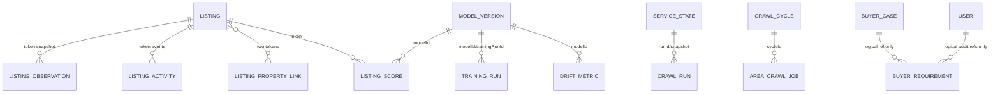
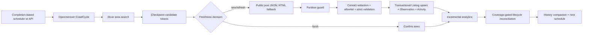
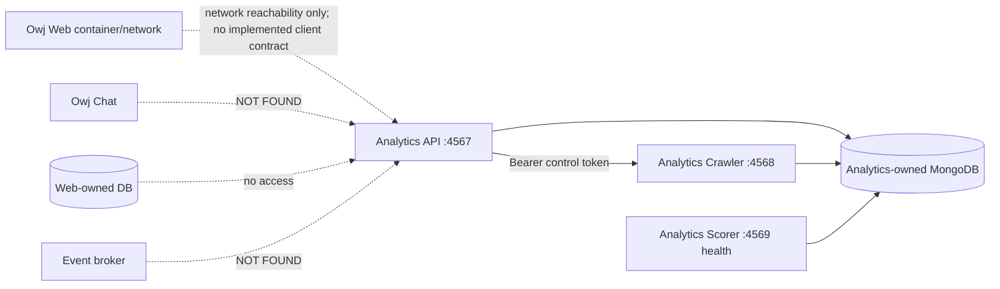

# Owj Market Analytics — Architecture, Integration, and Scalability Audit

**Audit date:** 2026-11-20  
**Repository:** `owj-market-analytics`  
**Git branch / commit:** `main` / `15b89b260c1fb040477c91aa447abdff0a29a691`  
**Method:** static, read-only source and configuration inspection. The real `.env`, production data, databases, external services, containers, and deployment host were not opened or contacted. Tests were inventoried but not executed.  
**Working-tree caveat:** `src/storage/mongoMarketStore.js` was already modified and `deploy/Dockerfile.offline-overlay` was already untracked when the audit began. This report describes the files as present in the workspace and does not attribute those changes to the audited commit.

> **Policy amendment (2026-11-20):** Sprint 1 withdrew the earlier prohibition on public real-estate business display names. Public `businessDisplayName` is permitted; private contact information, authenticated data, credentials, cookies, and personal identity remain prohibited. Findings below concerning business-name retention are superseded by this amendment.

## Status vocabulary

- **IMPLEMENTED** — confirmed in executable source.
- **PARTIALLY IMPLEMENTED** — core code exists but a material boundary or capability is missing.
- **CONFIGURED** — declared in configuration; runtime operation was not verified.
- **DOCUMENTED ONLY** — stated in prose but not established by executable code/configuration.
- **NOT FOUND** — explicitly searched for and absent.
- **UNKNOWN** — cannot be established from this repository.
- **RECOMMENDATION** — proposed work, not current behavior.

## 1. Executive Summary

This is the **Owj Market Analytics** repository. It is an independently deployable Node.js application that discovers public Tehran apartment-sale advertisements from Divar, extracts and sanitizes listing details, stores current and historical state, computes live spatial analytics and batch valuation/ranking models, exposes JSON APIs, and serves a React/Vite operational dashboard. The code supports MongoDB as the production authority and a local JSON compatibility/development mode (`src/runtime/createStore.js:5-16`, `src/storage/mongoMarketStore.js:79-114`).

Production is **CONFIGURED** as three containers built from one immutable image: `analytics-api`, `analytics-crawler`, and `analytics-scorer`. Only the API joins the external `web_app-network`; no production port is published to the host (`compose.production.yaml:23-109`). An ignored server snapshot configures Nginx TLS and HTTP Basic Authentication on a dedicated analytics subdomain and proxies to `analytics-api:4567` (`deploy/server-nginx.conf:28-81`). Because that file is ignored and runtime state was not inspected, the reverse proxy is **CONFIGURED, NOT VERIFIED**.

Implementation maturity is mixed:

- **IMPLEMENTED:** bounded Divar search, detail extraction, allowlisted listing projection, contact endpoint blocking, phone/email redaction, Mongo-backed durable crawl leases/checkpoints, observations and lifecycle history, bounded buyer matching, scoring/model version persistence, process health checks, resource logging, and a substantial test suite.
- **IMPLEMENTED under the amended policy:** the collector rejects contact/auth fields while retaining permitted public `businessDisplayName` values (`src/collector/divarPost.js:75-97`, `src/collector/publicListing.js:415-426`).
- **PARTIALLY IMPLEMENTED:** production isolation. Processes are split, but no CPU or memory limits are configured; Mongo startup loads all listings into memory in both API and crawler; batch scoring materializes the full dataset several times and performs quadratic comparable selection.
- **PARTIALLY IMPLEMENTED:** integration. Web can reach the API on a shared Docker network, and useful listing/search endpoints exist, but Analytics has no Owj Web identity validation, user authorization, service credentials, idempotency contract, save-to-Web operation, CRM task integration, or event bus.
- **NOT FOUND:** Socket.IO/WebSocket server, notifications, S3 usage, queue broker, CI/CD, backup automation, OpenTelemetry/metrics exporter, application-level authentication, per-role authorization, or cross-repository API clients.

At audit time, the highest risks were: unauthenticated state-changing API handlers if the Nginx boundary was bypassed or misconfigured; unbounded in-memory listing mirrors and quadratic scoring on an 8 GB host; absence of Compose memory/CPU limits; and no implemented cross-service identity/authorization contract. Sprint 1 changes should be assessed in its separate handoff rather than assumed by this static baseline.

## 2. Repository Identity and Technology Stack

| Item | Finding | Status / evidence |
|---|---|---|
| Purpose | Public-only real-estate ingestion, history, analytics, scoring, search, and dashboard | **IMPLEMENTED** — `package.json:2-5`; source paths below |
| Language/runtime | JavaScript ES modules on Node.js; JSX for frontend | **IMPLEMENTED** — `package.json:6`; no `.nvmrc` or `engines`, so exact Node version is **UNKNOWN** |
| Backend | Node core HTTP server; no Express/Fastify | **IMPLEMENTED** — `src/api/server.js:1,261-1060` |
| Frontend | React 19 + Vite 8 | **IMPLEMENTED** — `package.json:43-48`; `dashboard/vite.config.js:5-31` |
| Database | Mongoose 9 / MongoDB; JSON fallback | **IMPLEMENTED** — `package.json:40`; `src/runtime/createStore.js:5-16` |
| Browser automation | Playwright/Chromium 1.62.1 | **IMPLEMENTED** — `package.json:42`; `src/collector/publicCrawler.js:1-2,418-453` |
| AI | OpenAI transcription, structured filter extraction, and realtime speech | **IMPLEMENTED when key exists** — `src/services/openaiVoice.js:110-224` |
| Maps | Neshan browser map key, Nearby and pedestrian route services | **IMPLEMENTED when keys/services exist** — `src/services/neshanPlaces.js:57-193` |
| Package manager | npm with lockfile | **CONFIGURED** — `package-lock.json`; Docker runs `npm ci` (`Dockerfile:5-6`) |
| Build | Vite builds `dashboard/` into `public/`; production prunes dev dependencies | **CONFIGURED** — `package.json:14-15,34`; `Dockerfile:15` |
| Entrypoints | combined `src/index.js`; split API/crawler/scorer processes | **IMPLEMENTED** — `package.json:8-11` |
| Public UI | Seven logical pages plus listing/location parameterized pages | **IMPLEMENTED** — `dashboard/src/main.jsx:14-25` |
| Real-time transport | None | **NOT FOUND** — no Socket.IO/WebSocket server; OpenAI's outbound realtime WebSocket is not an application event channel |
| Object storage | None | **NOT FOUND** — no S3/AWS application integration |

### Entrypoints and lifecycle

| Entrypoint | Responsibility | Shutdown/recovery |
|---|---|---|
| `src/apiProcess.js` | Mongo/JSON store, live market engine, remote crawler proxy, HTTP API | SIGINT/SIGTERM closes HTTP, polling, store, monitor, logger (`src/apiProcess.js:29-48`) |
| `src/crawlerProcess.js` | Mongo-only crawler, control API, completion-based crawl schedule | Stops crawl, control server, store and timers (`src/crawlerProcess.js:27-65`) |
| `src/scorerProcess.js` | Polls crawler state every 30 s and invokes scoring after completed crawls | Flushes scoring, closes health server and Mongo (`src/scorerProcess.js:31-67`) |
| `src/index.js` | Legacy/compact all-in-one API+crawler+scorer mode | Completion-based schedule and coordinated shutdown (`src/index.js:39-118`) |
| `src/scoring/scoringWorker.js` | Worker thread: Mongo snapshot, cleaning, model training, scoring, Mongo publication, JSON artifacts | Disconnects Mongo in `finally` (`src/scoring/scoringWorker.js:9-43`) |

## 3. Directory and Module Architecture

| Path | Actual responsibility |
|---|---|
| `src/api/` | Core HTTP router, dashboard payloads, data-quality, location and scoring views |
| `src/collector/` | Divar discovery/detail requests, browser fallback, sanitation, classification, crawl planning, durable jobs and lifecycle history |
| `src/crawler/` | Auth-capable internal control server and API-side remote crawler client |
| `src/models/` | Fourteen Mongoose top-level models/collections plus nested schemas |
| `src/storage/` | Mongo authority, JSON fallback/snapshots, retry and retention helpers |
| `src/analytics/` | Incremental coordinate-cell analytics and online ridge model |
| `src/scoring/` | Cleaning, cross-validated ridge training, comparable scoring, scenarios, model registry and worker isolation |
| `src/search/` | Anonymous buyer-requirement normalization, Mongo filter, bounded ranking and cursor |
| `src/services/` | Neshan and OpenAI external-service adapters |
| `src/monitoring/`, `src/logging/` | Process resource sampling and structured/redacted logging |
| `dashboard/src/` | React single-page UI, client-side routing, catalog, matching, mapping and scoring screens |
| `schemas/` | JSON Schema documents for public listing, analysis, scoring and buyer-match contracts |
| `scripts/` | Explicit migrations, backfills, audits, score generation, recovery, enrichment and offline image transfer |
| `deploy/`, `compose*.yaml`, `Dockerfile` | Deployment examples, production topology and image build |
| `test/` | Node built-in test runner suite; 145 `test(...)` declarations across 38 files |

## 4. Complete Database Model Inventory

MongoDB database name is environment-dependent (`MONGODB_DB_NAME`, default `owj_market_analytics`); URI may be Atlas or any compatible Mongo deployment. Example production configuration uses an Atlas-style URI, but actual production placement was not inspected (`src/config.js:24-26`; `deploy/env.production.shared.example:2-4`). Mongoose default pluralized collection names are listed below.

| # | Model / collection | Field groups and rules | Indexes / lifecycle | Readers and writers / sensitivity |
|---:|---|---|---|---|
| 1 | `Listing` / `listings` | Strict v1/v2 public record: immutable token, canonical URL/title/description; location; crawl partition; property/details; TOMAN sale/rent pricing; 14 tri-state amenities; allowlisted attributes/images; advertiser classification and `businessDisplayName`; media claim; coordinates/nearby transit; extraction/quality/lifecycle; timestamps/fingerprint | Unique token; property-link candidate, location, lifecycle/quality, advertiser, partition, coordinate, nearby and four buyer-match compound indexes (`src/models/listing.js:59-132`) | Read by all analytics/search/API/scoring flows; written by crawler/enrichment. Coordinates, free text, images and business identity are privacy-sensitive |
| 2 | `ListingObservation` / `listingobservations` | Token, observedAt, runId, eventType `created|changed|legacy-import`, fingerprint, full cloned Listing snapshot; timestamps | Token/time; run/time; unique token+fingerprint+time+run (`src/models/listingObservation.js:9-26`) | Crawler writes changed snapshots; history API reads projections. Multiplies storage and repeats sensitive listing fields |
| 3 | `ListingActivity` / `listingactivities` | Deterministic eventId, token/run/time, event type, observation/inference basis, fingerprint, prices, unresolved property identity | Unique eventId; token/time; run/type/time; type/time; time (`src/models/listingActivity.js:3-22`) | Crawler lifecycle writes; history/summary reads; no direct personal identity |
| 4 | `ListingPropertyLink` / `listingpropertylinks` | Pair of sorted tokens; relation `same-property|repost|different-properties`; candidate/confirmed/rejected; shared-image/shape evidence; confirmation requires `verificationRef` pre-validation hook | Unique linkId; tokens/status/time; time/status/relation (`src/models/listingPropertyLink.js:3-24`) | New-listing similarity creates candidates; history reads. No automatic confirmation |
| 5 | `ServiceState` / `servicestates` | Singleton key `crawler`, schemaVersion, updatedAt, nested crawl snapshot and planning offsets | Unique key (`src/models/crawlState.js:65-72`) | Crawler writes frequent checkpoints; API/scorer read. Holds operational errors/metrics, not customer data |
| 6 | `CrawlRun` / `crawlruns` | Immutable runId, start/end/status/update and full crawl snapshot | Unique runId; start/status; status/end (`src/models/crawlState.js:74-86`) | Checkpoint writes via replacement; run API/scorer reads |
| 7 | `CrawlCycle` / `crawlcycles` | Cycle/scope/mode/status, up to 168 partitions, cursor, owner lease, cooldown/completion/expiry | Unique cycleId; one partial unique active scope; TTL `expiresAt` (`src/models/crawlJob.js:16-31`) | Durable queue owns; 35-day cycle retention |
| 8 | `AreaCrawlJob` / `areacrawljobs` | Job/cycle/area/limit; staged priority; queue/running/completed/failed state; lease; retries; cursor; max 100 candidate tokens/outcomes; error/expiry | Unique jobId and cycle+area; claim/status/lease/coverage indexes; TTL expiry (`src/models/crawlJob.js:33-71`) | Durable crawler owns; 30-day job retention |
| 9 | `ModelVersion` / `modelversions` | Immutable modelId; batch/online kind; version/status/times; parent/training links; Mixed dataset, metrics and artifact | Unique modelId; kind/status/time; one partial unique active model per kind (`src/models/scoringState.js:6-25`) | Scorer/model registry writes; API reads and can promote/rollback |
| 10 | `TrainingRun` / `trainingruns` | Run/pipeline/scoring versions, status/times/duration/counts/modelId, Mixed metrics/error | Unique runId; start/status (`src/models/scoringState.js:27-43`) | Scoring generation writes; API reads |
| 11 | `ListingScore` / `listingscores` | Token/run/model/version/time/rank; recommendation/deal/confidence/quality/risk/band; full Mixed score snapshot | Token/time; unique run+rank; model+rank; model/filter indexes; scoring version/time (`src/models/scoringState.js:45-71`) | Scorer writes one row per listing per generation; catalog, history and scoring APIs read. Historic rows are compacted only partially |
| 12 | `DriftMetric` / `driftmetrics` | Drift/model/baseline/time/severity and Mixed metrics | Unique driftId; model/time; severity/time (`src/models/scoringState.js:73-92`) | Model registry writes; API reads |
| 13 | `ScoringScenario` / `scoringscenarios` | Scenario id/name/description; strict numeric weight/threshold config and neighborhood score map; source version, active flag, explicit timestamps | Unique scenarioId; active/time; name (`src/models/scoringScenario.js:6-41`) | Public API creates/replaces and reads; scenario computation reads |
| 14 | `BuyerRequirement` / `buyerrequirements` | CRM-shaped buyerCase/User refs, transaction/property/location/budget/area/room/amenity fields, urgency/finance/notes/status/version/audit users | BuyerCase+status+time; status/type/time; field-level indexes (`src/models/buyerRequirement.js:13-65`) | **Declared and initialized but not persisted/read by runtime matching.** The API accepts anonymous criteria and searches listings only (`src/api/server.js:384-435`). Contains customer/workflow identifiers if ever used |

### Nested schemas with domain significance

- Listing `quality.outcome` gates scoring; only buy-apartment listings with area, price and resolved location become `scoring-ready` (`src/collector/listingPolicy.js:3-12`).
- Listing lifecycle progresses `active → not-seen → possibly-removed → removed` only after exhaustive area coverage and repeated misses (`src/collector/listingPolicy.js:35-40`; `src/storage/mongoMarketStore.js:441-481`). A removal is inference, not proof of sale.
- Crawl jobs use cycle and per-job fenced leases. Checkpoint writes require current owner and unexpired lease (`src/collector/durableCrawlQueue.js:37-39,93-129`).
- Observation embeds a complete listing snapshot, so one listing may be stored in current state, observations, and current/historical score snapshots.
- Mixed model artifacts/metrics and score snapshots trade schema safety for flexibility; application validation, not Mongoose shape validation, protects their internal structure.

### Ownership and relationships

**IMPLEMENTED:** this repository owns all 14 collections when Mongo mode is active. It has one local `mongoose.connect` connection per process, with pool 20/2 in the store and 5/1 in the scorer (`src/storage/mongoMarketStore.js:79-91`; `src/scorerProcess.js:15-18`). No code reads or writes a sibling repository's collections. `BuyerRequirement` contains logical refs to `BuyerCase` and `User`, but those models are absent and population is not used; it is a temporary duplicate schema, not an implemented cross-database relationship.

No relationship to Web users, consultants, agencies, Web properties, CRM tasks, Chat conversations, or Chat messages is implemented.

## 5. Complete API Inventory

There are **58 JSON/health endpoint contracts**: 51 public API route/method paths, six crawler-control endpoints, and one scorer health endpoint. The count treats `/data-quality`'s JSON content-negotiated alias and optional `/locations/:id` as distinct paths. It excludes nine SPA page paths and `/assets/:file`.

### Main analytics API — 51 endpoints

All routes below are handled in `src/api/server.js:261-1057`. **Authentication/authorization: NOT FOUND in application code.** The ignored Nginx snapshot applies Basic Auth to the entire analytics subdomain, but direct container-network callers bypass it. JSON bodies default to a 1 MB limit; specialized handlers use 2 KB, 8 KB, or 64 KB; audio is capped at 12 MB (`src/api/server.js:99-123`). Errors are JSON with a request ID; 500 responses suppress the message (`src/api/server.js:1043-1056`).

| # | Method and path | Contract / models or services / side effects | Evidence |
|---:|---|---|---|
| 1 | `GET /health` | Service/mode/time/resource snapshot, listing count, crawl guardrails and local artifact paths; reads in-memory store/crawler | `server.js:277-300` |
| 2 | `GET /map-config` | Returns provider, **public** map key and enabled flags | `server.js:302-309` |
| 3 | `GET /listing-facets` | Distinct neighborhoods/categories and min/max bounds; Mongo distinct/aggregation | `server.js:311-314`; `mongoMarketStore.js:220-227` |
| 4 | `GET /ai/voice/status` | Exposes configured state and model names, never key | `server.js:316-323` |
| 5 | `POST /ai/voice/catalog-filters` | 12 MB allowlisted audio → OpenAI transcription and structured filter extraction; reads facets/scenarios; concurrency limited by OpenAI service | `server.js:325-351`; `openaiVoice.js:120-180` |
| 6 | `POST /ai/voice/speech` | `{text}` 1–800 chars → OpenAI realtime WAV; 8 KB body | `server.js:354-369` |
| 7 | `GET /buyer-matches/options` | Anonymous filter options from listing facets | `server.js:371-382` |
| 8 | `POST /buyer-matches/search` | Strict normalized anonymous requirement plus cursor/page; Mongo candidate cap, query timeout, in-process concurrency cap; no BuyerRequirement/customer persistence | `server.js:384-439`; `buyerMatcher.js:39-180` |
| 9 | `GET /data-quality-data` | Full in-memory data-quality baseline plus score/report artifacts | `server.js:441-450` |
| 10 | `GET /data-quality` with non-HTML `Accept` | Alias of prior JSON endpoint; HTML clients receive SPA later | `server.js:441-450,974-992` |
| 11 | `GET /dashboard` | Aggregate crawl, analytics, full listing set, scoring and recent logs; potentially large CPU/payload | `server.js:453-493` |
| 12 | `GET /scores` | Offset/limit (≤500), query/band/sort over active score document; sorts filtered in memory | `server.js:495-547` |
| 13 | `GET /score-details/:token` | Detailed active score and optional full score snapshot | `server.js:549-562` |
| 14 | `GET /score-analytics-data` | Scoring distributions/validation from active scores and report | `server.js:564-573` |
| 15 | `GET /score-workshop-data` | Inputs required for scenario simulation | `server.js:575-579` |
| 16 | `GET /model-versions` | `kind`, `limit≤500`; ModelVersion list | `server.js:581-586` |
| 17 | `GET /training-runs` | `limit≤500`; TrainingRun list | `server.js:588-592` |
| 18 | `GET /model-drift` | `limit≤500`; DriftMetric list | `server.js:594-598` |
| 19 | `POST /model-versions/:modelId/promote` | **Mutation:** archives current and activates target model transactionally where supported | `server.js:600-604`; `modelRegistry.js:187-208` |
| 20 | `POST /model-versions/rollback` | **Mutation:** body kind; activates latest archived model | `server.js:606-613`; `modelRegistry.js:210-220` |
| 21 | `GET /listings/:token/score-history` | ListingScore history, limit≤500 | `server.js:615-623` |
| 22 | `GET /scoring-scenarios` | Active ScoringScenario list | `server.js:625-629` |
| 23 | `POST /scoring-scenarios` | **Mutation:** validates and creates scenario; 1 MB default body | `server.js:631-638`; `scenarioService.js:16-47` |
| 24 | `PUT /scoring-scenarios/:scenarioId` | **Mutation:** full validated replacement; no optimistic version check | `server.js:640-650` |
| 25 | `GET /scoring-scenarios/:scenarioId/scores` | Recalculates/cache scenario over full score document; listing and score filters; page≤40 | `server.js:652-687` |
| 26 | `GET /listings/:token/scenario-scores` | Recalculates every active scenario and finds token | `server.js:689-706` |
| 27 | `GET /scoring-report` | Reads local scoring-report JSON, 404 if absent | `server.js:708-713` |
| 28 | `POST /crawl` | **Control mutation:** asks local/remote crawler to start; 202/409 | `server.js:715-719` |
| 29 | `GET /crawl` | Current crawler snapshot | `server.js:721-723` |
| 30 | `POST /area-crawl-jobs` | **Control mutation:** `{areaId}` only, 2 KB body; priority/targeted crawl, cooldown semantics | `server.js:725-743` |
| 31 | `GET /area-crawl-jobs/:jobId` | Area job status | `server.js:745-751` |
| 32 | `GET /crawl-runs` | CrawlRun list, limit≤200 | `server.js:753-757` |
| 33 | `GET /crawl-coverage` | Latest durable area-job aggregation | `server.js:759-766` |
| 34 | `GET /collection-summary` | Since-date ListingActivity/PropertyLink aggregates, 5 s DB max time | `server.js:768-773`; `mongoMarketStore.js:328-341` |
| 35 | `GET /listings/:token/history` | Bounded activities, observation projections and property links; `limit≤100`, `before` | `server.js:775-791` |
| 36 | `GET /listings` | Catalog filters; offset≤1,000,000, limit≤40; Mongo query when available, in-memory subset otherwise | `server.js:793-843`; `mongoMarketStore.js:146-218` |
| 37 | `GET /listings/:token` | Full public listing with coordinates rounded to 4 decimals | `server.js:845-851`; `server.js:188-199` |
| 38 | `POST /listings/:token/refetch` | **Mutation/external call:** immediate Divar detail refetch and persistence | `server.js:853-866` |
| 39 | `POST /listings/:token/nearby-places` | **Mutation/external calls:** Neshan nearby/routes, then Listing replacement | `server.js:868-890` |
| 40 | `GET /locations` | Iran location view over full in-memory listings/scores | `server.js:892-903` |
| 41 | `GET /locations/:identifier` | Specific hierarchy view | `server.js:892-903` |
| 42 | `GET /listings/:token/analysis` | Live spatial/comparable analysis; scans listings | `server.js:905-910`; `marketEngine.js:369-452` |
| 43 | `GET /areas` | All computed coordinate-cell spatial metrics | `server.js:912-919` |
| 44 | `GET /areas/:areaId` | Filters computed metrics after recomputing all | `server.js:921-930` |
| 45 | `GET /recommendations` | `limit≤100`; analyzes and sorts all in-memory listings | `server.js:932-940`; `marketEngine.js:454-477` |
| 46 | `GET /analytics` | Local analytics JSON or live public snapshot | `server.js:942-947` |
| 47 | `GET /events` | Up to 500 recent structured log records | `server.js:949-952`; `logger.js:81-83` |
| 48 | `GET /schemas/public-listing` | Serves JSON Schema | `server.js:954-957` |
| 49 | `GET /schemas/scoring-ready` | Serves JSON Schema | `server.js:959-962` |
| 50 | `GET /schemas/scored-listings` | Serves JSON Schema | `server.js:964-967` |
| 51 | `GET /schemas/buyer-match-request` | Serves JSON Schema | `server.js:969-972` |

### Crawler control API — six internal endpoints

Bearer authentication is applied to every request **only if** a token is configured (`src/crawler/controlServer.js:9-13`). Production Compose requires the token variable and passes it to API and crawler (`compose.production.yaml:14,39,74`). Each remote request has a 120 s timeout; no retry is implemented (`src/crawler/remoteCrawler.js:14-23`).

| Method/path | Operation | Evidence |
|---|---|---|
| `GET /health` | Crawler health | `controlServer.js:15` |
| `GET /state` | Crawler snapshot | `controlServer.js:16` |
| `POST /crawl` | Start crawl | `controlServer.js:17` |
| `POST /area-jobs/:areaId` | Start/prioritize area job | `controlServer.js:18-19` |
| `GET /area-jobs/status/:jobId` | Job state | `controlServer.js:20-21` |
| `POST /refetch/:token` | Divar refetch and persistence | `controlServer.js:22-23` |

### Scorer health and SPA routes

- `GET /health` on port 4569 returns scorer role/running; all other paths return 404. It has no application auth but is not published in production (`src/scorerProcess.js:23-29`; `compose.production.yaml:80-98`).
- SPA HTML routes: `/`, `/score-analytics`, `/score-workshop`, `/data-quality`, `/catalog`, `/buyer-matching`, `/explore`, `/explore/:slug`, `/listing/:token`; assets use `/assets/:file` (`src/api/server.js:974-1004`).

## 6. Services and Business Logic

The audit identifies **28 significant service/business modules**:

1. HTTP router/static server (`src/api/server.js`).
2. API-side `RemoteCrawler` proxy/poller (`src/crawler/remoteCrawler.js`).
3. `PublicCrawler` coordinator (`src/collector/publicCrawler.js`).
4. Internal crawler control server (`src/crawler/controlServer.js`).
5. Durable crawl queue/leases (`src/collector/durableCrawlQueue.js`).
6. Durable cycle staged executor (`src/collector/runDurableCycle.js`).
7. Adaptive crawl planning/request budget (`src/collector/crawlPlanning.js`).
8. Tehran area loader/partition builder (`src/collector/tehranAreas.js`).
9. Divar public search client (`src/collector/divarSearch.js`).
10. Browser discovery fallback (`src/collector/browserSearch.js`).
11. Divar public post adapter (`src/collector/divarPost.js`).
12. Public listing sanitation/validation (`src/collector/publicListing.js`).
13. Advertiser classifier (`src/collector/advertiserClassifier.js`).
14. Freshness/quality/lifecycle policy (`src/collector/listingPolicy.js`).
15. Listing activity/property-link derivation (`src/collector/listingHistory.js`).
16. Mongo authoritative store (`src/storage/mongoMarketStore.js`).
17. JSON fallback/compatibility store (`src/storage/jsonStore.js`).
18. Mongo transient retry (`src/storage/mongoRetry.js`).
19. Incremental live market engine (`src/analytics/marketEngine.js`).
20. Scoring cleaner (`src/scoring/cleanListings.js`).
21. Cross-validated ridge model (`src/scoring/ridgePriceModel.js`).
22. Comparable/value scoring machine (`src/scoring/scoringMachine.js`).
23. Scoring pipeline/artifact writer (`src/scoring/pipeline.js`).
24. Live scoring scheduler/worker-thread launcher (`src/scoring/liveScoring.js`).
25. Model registry/promotion/drift service (`src/scoring/modelRegistry.js`).
26. Scenario validation/recalculation (`src/scoring/scenarioService.js`).
27. Buyer matching (`src/search/buyerMatcher.js`).
28. Neshan, OpenAI, resource monitor and structured logger as infrastructure adapters (`src/services/*`, `src/monitoring/resourceMonitor.js`, `src/logging/logger.js`).

### Primary crawl workflow

Retries are exponential and bounded; 403/429 are deliberately not retried and trigger cooldown/stop behavior (`src/collector/retry.js:1-54`; `src/collector/publicCrawler.js:1002-1017`). Request concurrency and per-minute/run budgets are configurable. Detail workers are bounded by `ANALYTICS_DETAIL_CONCURRENCY`; targeted jobs force concurrency 1 (`src/collector/publicCrawler.js:1033-1077,1079-1153`). Listing upsert/observation/activity is transactional when Mongo supports transactions (`src/storage/mongoMarketStore.js:358-411`). Replays are mostly idempotent through unique tokens, fingerprints and deterministic activity IDs.

### Scoring workflow

Completed crawl state → scorer poll (30 s) → worker thread → full Mongo Listing read → JSON snapshot → clean/impute/reject → five-fold robust ridge training → per-listing comparable scan and score → ModelVersion/TrainingRun/ListingScore/DriftMetric persistence → four JSON artifacts (`src/scorerProcess.js:31-50`; `src/scoring/scoringWorker.js:9-42`; `src/scoring/pipeline.js:34-149`). A completed generation automatically archives the previous active batch model and activates the new one (`src/scoring/modelRegistry.js:124-177`).

### Buyer matching workflow

Anonymous body → allowlist normalization → hard Mongo filter for active/scoring-ready listings → max 500 configured candidates and 2 s configured query timeout → in-process ranking using price/area/amenities/current market score/freshness → fingerprinted cursor response. Customer identity and notes are intentionally dropped (`src/api/server.js:384-435`; `src/search/buyerMatcher.js:39-180`). The declared `BuyerRequirement` collection is not used.

### Duplicate/parallel logic

- Catalog filters exist in both server in-memory helpers and Mongo query construction (`src/api/server.js:126-180`; `src/storage/mongoMarketStore.js:146-218`).
- JSON and Mongo stores implement parallel history/lifecycle behavior.
- There are two scoring systems: incremental online ridge in `marketEngine.js` and batch cross-validated ridge/comparable scoring in `src/scoring/`; both surface recommendations with different semantics.
- Scenario scoring exists server-side and a related client calculation model exists in `dashboard/src/scoringWorkshopModel.js`, increasing drift risk.

## 7. Authentication and Authorization

| Question | Finding |
|---|---|
| User identity owner | **NOT FOUND/UNKNOWN.** Analytics defines no User model or login; BuyerRequirement refs point to absent Web concepts |
| Login/session/JWT/cookies | **NOT FOUND.** No session or JWT middleware exists |
| Role/agency/consultant checks | **NOT FOUND** |
| Disabled-account handling | **NOT FOUND** |
| Web identity verification | **NOT FOUND** |
| Acting on behalf of a user | **NOT FOUND** |
| Service-to-service auth | **PARTIAL:** optional Bearer token between API and crawler only; no Web↔Analytics credential contract |
| Edge auth | **CONFIGURED, NOT VERIFIED:** ignored Nginx snapshot uses HTTP Basic Auth for analytics host (`deploy/server-nginx.conf:50-81`) |

Every main API mutation trusts any caller that can reach port 4567. This includes model activation, scenario writes, crawl triggers, Divar refetch and Neshan-enrichment spend. Production does not publish the port, but the API is deliberately attached to `web_app-network`; any container on that network can call it without identity or permission checks (`compose.production.yaml:45-48`).

## 8. Frontend and User Workflows

| Route/page | Role assumed | API dependencies | Status / concerns |
|---|---|---|---|
| `/` overview | Operator | `/dashboard`, `/scores`, crawl control | **IMPLEMENTED**; polls/refreshes and receives broad operational data; no in-app authorization |
| `/catalog` | Analyst/consultant | listings, facets, scenarios, voice AI | **IMPLEMENTED**; server pagination ≤40; browser microphone/audio may be sent to OpenAI after user action |
| `/listing/:token` | Analyst/consultant | listing, score detail, scenario scores, history, Neshan enrichment/refetch | **IMPLEMENTED**; exposes state-changing buttons through unauthenticated API |
| `/buyer-matching` | Consultant-like workflow | buyer options/search | **PARTIALLY IMPLEMENTED**; anonymous criteria only; no CRM customer identity, save action or audit trail |
| `/explore/:slug` | Analyst | location view and area crawl jobs | **IMPLEMENTED**; UI can trigger collection work |
| `/score-analytics` | Operator | scoring analytics | **IMPLEMENTED** |
| `/score-workshop` | Operator | workshop data and scenario CRUD | **IMPLEMENTED**; saved scenario mutation lacks role controls |
| `/data-quality` | Operator | data-quality data | **IMPLEMENTED** |

State uses local React hooks rather than a shared store; routing is path matching, not React Router (`dashboard/src/main.jsx:14-25`). Loading/error components exist. Catalog and scenario lists paginate/filter, while dashboard/location/data-quality endpoints still process broad in-memory datasets. No frontend call to Owj Web or Chat was found.

## 9. Background Workers and Scheduled Jobs

| Worker/job | Trigger/schedule | Concurrency/persistence/retry/restart |
|---|---|---|
| Full crawler | Auto at startup then 6 h default after successful completion; API/manual trigger | One crawler lock; configurable detail concurrency (prod 2), request budget 24/min; Mongo cycle/job leases, cursors and TTL; retry/cooldown; restart recovers expired leases (`crawlerProcess.js:27-45`; `durableCrawlQueue.js:37-155`) |
| Targeted area crawl | `POST /area-crawl-jobs` | Shares crawler lock/budget; queue limit/cooldown; concurrency 1; persisted when durable queue active (`publicCrawler.js:256-361,1079-1199`) |
| Scorer poller | Every 30 s | One process; compares completed crawl end with active model generation, spawns at most one worker and debounces/min-intervals (`scorerProcess.js:31-50`; `liveScoring.js:24-92`) |
| Scoring worker thread | Completed crawl/live request/manual script | Full-dataset CPU/RAM isolated from event loop, not from container resources; failures logged; no persisted job queue, but next scorer poll can retry if active model remains stale |
| API crawler-state poll | Every 5 s | RemoteCrawler timer; failure changes snapshot to unavailable; no backoff (`remoteCrawler.js:26-38`) |
| Resource sampling | Every 60 s production | Per process, unref'd timer; logs memory/ELU/event-loop delay (`resourceMonitor.js:7-49`) |
| Retention | End of a full crawl | Observation cap per token and two named debug artifacts; no general score/model/activity retention (`publicCrawler.js:1304-1312`) |

Operational scripts are manual and may mutate Mongo/external systems; they are not scheduled by application code. They cover migrations, scoring, Neshan enrichment, recovery, backfill, reclassification, compaction and destructive reset (`package.json:16-33`).

## 10. Real-Time Communication

**NOT FOUND:** no Socket.IO server/client, WebSocket endpoint, SSE, message broker, notifications, subscriptions, or change streams. The frontend uses HTTP fetch. The only WebSocket is an outbound OpenAI realtime speech connection (`src/services/openaiVoice.js:182-223`). Therefore Socket.IO event count is **N/A (0)** and Web/Chat real-time integration is absent.

## 11. Database Operations and Data Flow

1. Divar area search persists only token/URL in the durable checkpoint (`src/collector/runDurableCycle.js:35-38,67-88`).
2. Public detail JSON is adapted in memory; HTML is fallback after non-limit API failure (`src/collector/publicListing.js:514-582`).
3. The projection allowlists attributes/amenities, strips image URL query strings, redacts contact-like text, rejects forbidden keys recursively, resolves location and fingerprints content (`src/collector/publicListing.js:15-31,78-143,248-331,334-488`).
4. Current Listing, changed Observation and Activities commit together where transactions are available (`src/storage/mongoMarketStore.js:358-404`).
5. Every Mongo store process reads **all listings** into an in-memory Map on startup (`src/storage/mongoMarketStore.js:103-108`). API reads are a mix of Mongo pagination and in-memory analytics.
6. Scoring copies all Mongo listings to a JSON file, materializes cleaned/scored arrays, then stores model metadata and one ListingScore per listing (`src/scoring/scoringWorker.js:17-24`; `src/scoring/pipeline.js:55-147`).
7. Mongo is authoritative in configured production; JSON artifacts are compatibility/derived data. JSON fallback owns local records, snapshots and observation files when `MONGODB_URI` is absent (`src/runtime/createStore.js:5-16`).

## 12. External Integrations

| External system | Protocol/data | Credentials/timeouts/retries | Status |
|---|---|---|---|
| Divar search API | HTTPS POST area/category payload; tokens only | No credentials/cookies; Playwright request context; bounded pages/stalls/budget | **IMPLEMENTED** — `divarSearch.js:4,16-168` |
| Divar post API | HTTPS GET public post; optional public business lazy POST | No credentials; 15 s; bounded retry wrapper; contact URL block | **IMPLEMENTED**, privacy issue — `divarPost.js:5-112` |
| Divar HTML | Headless Chromium search/detail fallback | Fresh unauthenticated context; contact routes blocked; navigation timeout | **IMPLEMENTED** — `publicCrawler.js:407-489` |
| Divar place catalog | HTTPS public JSON / bundled fallback | Public request | **IMPLEMENTED** — `tehranAreas.js:1-170` |
| MongoDB | Mongoose | URI/name env; retry on transient errors; pool limits | **IMPLEMENTED**, actual host **UNKNOWN** |
| Neshan | Browser key returned to UI; server key for nearby/routes | 15 s; no general retry; per-call route concurrency≤6 | **IMPLEMENTED when configured** — `neshanPlaces.js:57-193` |
| OpenAI | Audio transcription, Responses structured output, realtime audio | Server key; timeout; SDK retry 1; concurrency default 2 | **IMPLEMENTED when configured** — `openaiVoice.js:110-224` |
| Nginx/Let's Encrypt | TLS, Basic Auth, reverse proxy | External to repo runtime | **CONFIGURED snapshot, unverified** — `deploy/server-nginx.conf` |

## 13. Cross-Repository Integration

### Existing dependency map

`analytics-api` joining `web_app-network` is the only executable/configured Web connection (`compose.production.yaml:45-48,103-105`). No Analytics source imports sibling code, calls a Web/Chat hostname, or writes their databases.

### Workflow readiness

**A — Web searches Analytics: REQUIRES CHANGES.** `GET /listings`, facets, listing detail, analysis, scores, locations and buyer matching are useful implemented contracts. However, they have no service authentication, user context, role authorization, stable versioned base path, or explicit availability/SLA contract. Nginx Basic Auth is user/edge-oriented and unsuitable as the sole Web service credential.

**B — Save Analytics listing to Web: BLOCKED.** Analytics provides a public listing token and full sanitized record, but there is no save endpoint/client/event, Web identity, idempotency key, Web `Poster` reference, or ownership decision implemented. Analytics must not write Web collections. Web should own the mutation and decide whether to reference token/version or copy an allowlisted snapshot.

**C — Chat creates a CRM task: UNKNOWN from this repository.** No Chat or CRM code exists here, and Analytics has no involvement. The correct boundary must be a Web-owned authorized, idempotent API/event; nothing in this repository establishes whether it exists.

**D — Analytics recommendations inside CRM: REQUIRES CHANGES.** Anonymous buyer matching already accepts property criteria without names or customer identity and is therefore a useful privacy-preserving computation boundary. It is not authenticated/versioned for service use, and the temporary BuyerRequirement schema incorrectly duplicates Web/CRM identifiers. Web should send only normalized criteria and retain customer identity itself.

## 14. Docker, Deployment, and Infrastructure

### Production topology

| Service | Command/internal port | Network/volume | Health/restart/resource config |
|---|---|---|---|
| `analytics-api` | `start:api`, 4567 | `analytics-internal` + external `web_app-network`; no data volume | HTTP health, `unless-stopped`, init, pids 200; no CPU/RAM limit |
| `analytics-crawler` | `start:crawler`, 4568 | `analytics-internal`; `crawler-data:/app/data`; shm 512 MB | Bearer health, pids 300; no CPU/RAM limit |
| `analytics-scorer` | `start:scorer`, 4569 | `analytics-internal`; `scorer-data:/app/data` | HTTP health, pids 200; no CPU/RAM limit |

Evidence: `compose.production.yaml:23-109`. `analytics-internal` is named internal but explicitly `internal: false`, so it is not an egress-isolated Docker network (`compose.production.yaml:100-102`). No host ports are published. API startup depends on crawler and scorer being healthy, coupling public API availability to both background workloads (`compose.production.yaml:40-44`).

The development Compose runs the legacy all-in-one process, publishes `4567:4567`, mounts data/logs and grants 1 GB shared memory (`compose.yaml:3-34`). This topology materially differs from production.

### Image and offline deployment

The Playwright Ubuntu base includes browsers; the Dockerfile installs locked dependencies, builds Vite assets, prunes dev dependencies and defaults to combined mode (`Dockerfile:1-27`). Production overrides the command per process. `scripts/build-offline-image.sh` builds linux/amd64, saves a gzip archive and checksum; `scripts/load-offline-image.sh` verifies SHA-256 before `docker load`. Compose requires an immutable image tag (`compose.production.yaml:4`). Two approximately 1 GB compressed archives are currently present in the workspace but ignored; they create local disk pressure and are not source artifacts.

The untracked overlay Dockerfile inherits a named base image and copies source without rebuilding dashboard assets or reinstalling dependencies (`deploy/Dockerfile.offline-overlay:1-12`). It is **CONFIGURED/UNVERIFIED** and can ship stale `public/` assets if used without a separately rebuilt bundle.

### Persistence and artifact mismatch

Mongo is the shared authority, but local files are not shared among production containers: crawler and scorer have different named volumes; API has none. Consequently, scorer-produced `scoring-report.json` and crawler-produced `analytics.json` are not visible to the API. Mongo-backed score routes work, but `/scoring-report` and file-fallback/report portions of dashboard/data-quality can be absent or stale (`compose.production.yaml:71-72,91-92`; `server.js:445-446,708-713,942-946`). This is a concrete deployment/code mismatch.

### Operations not established

- **CI/CD:** NOT FOUND.
- **Automated backups/restore tests:** NOT FOUND.
- **Automated rollback:** NOT FOUND; offline immutable images permit manual rollback, but database compatibility must be managed manually.
- **Resource reservations/limits:** NOT FOUND.
- **Central metrics/alerts/traces:** NOT FOUND; structured Docker logs and health endpoints only.
- **S3/media persistence:** NOT FOUND; external image URLs are stored, not downloaded.

## 15. Resource Usage and Scalability

No runtime benchmark or production metrics were inspected; impacts below are code-based risks, not claims of observed incidents.

| Severity | Concrete issue | Evidence and likely impact | Recommendation |
|---|---|---|---|
| Critical | Full Listing collection mirrored in each MongoMarketStore process | `find({}).lean()` materializes all documents before filling Map (`mongoMarketStore.js:103-108`). API and crawler each retain a copy; documents include images, descriptions and nearby places. Memory grows with collection size | Use bounded caches/query-first services; crawler loads only required tokens/partitions; quantify heap per listing |
| Critical | Batch scoring is full-dataset and quadratic | Worker loads all Mongo docs, serializes large JSON, cleaning/scoring retains multiple arrays; `localEvidence` scans every record for every subject (`scoringWorker.js:17-24`; `pipeline.js:55-147`; `scoringMachine.js:55-85,263-304`) | Spatial index/buckets or Mongo geo preselection; streaming/chunked artifacts; enforce worker memory/CPU limits |
| High | Live recommendations/comparables repeatedly scan the full Map | Spatial metrics, each analysis and each comparable selection traverse/sort all listings; recommendations analyze every listing (`marketEngine.js:220-317,369-477`) | Cache spatial indexes/metrics and invalidate incrementally; paginate/precompute recommendations |
| High | No container CPU/RAM limits on 4 vCPU/~8 GB host | Only pids/shm/log rotation configured (`compose.production.yaml:15-19,48,69,90`) | Set reservations/limits after measurement; schedule scoring away from crawl peaks |
| High | Score-filter catalog can read 20,000 score rows then `$in` all tokens | `mongoMarketStore.js:185-207` | Aggregate/join in Mongo or denormalize active score fields; page from score index |
| High | Offset pagination permits skip up to 1,000,000 | `listingPagination.js:3-11`; Mongo uses `.skip(offset)` (`mongoMarketStore.js:210-213`) | Keyset cursor on `(lastSeenAt, token)` |
| Medium | Regex query across four fields is not text-index backed | `mongoMarketStore.js:168-172`; declared indexes do not cover regex | Search index/text strategy; minimum query length and timeout |
| Medium | Scenario/listing score endpoints recalculate whole scenarios | `server.js:652-706`; cache max 24 is process-local | Persist/version scenario results or compute asynchronously; bound active scenarios |
| Medium | Observation and scores grow without general retention | Observation cap runs only after full crawl; old ListingScore/ModelVersion/Activity rows have no TTL (`mongoMarketStore.js:484-497`; model schemas) | Explicit retention/archive policy and storage monitoring |
| Medium | Mongo retry applies to selected store calls, not every query | Many direct model calls in API/scenario/lifecycle paths | Centralize transient retry/read concern policy and avoid retrying non-idempotent work blindly |
| Medium | Logging can be verbose | Default config level is `debug`; production example overrides `info`; request/resource logs add volume (`config.js:206`; `compose.production.yaml:15-19`) | Keep production info, sample high-volume events, alert on rotations/drops |

Horizontal scaling is **PARTIAL**: crawl leases prevent concurrent cycle owners and Mongo supports shared state, but API caches/Maps are per process, rate/concurrency limits are per process, scenario caches are local, and model/scoring activation assumes a single logical scorer. No distributed API rate limiter or leader election exists outside crawl leases.

## 16. Security and Privacy

### Verified safeguards

- Fresh Playwright API/browser contexts contain no configured login cookies or authenticated state (`publicCrawler.js:407-425`).
- Contact endpoints matching `/postcontact/` or `contact_info` are blocked; 403/429 stop work (`publicCrawler.js:27-33,428-489`).
- Public listing fields are allowlisted; unknown attributes are discarded; contact/credential/chat keys are recursively rejected (`publicListing.js:15-31,136-143,295-331`).
- Phone-like and email-like text is replaced; obvious identity-channel description lines are dropped; image URL query strings/userinfo are removed (`publicListing.js:78-133,248-255`).
- Structured logger redacts sensitive keys and phone/email-like strings (`logger.js:4-23`).
- Request bodies and result sizes are bounded in many endpoints; buyer DB queries have configured candidate/time/concurrency limits.
- Static responses set a CSP, though inline styles are allowed (`server.js:75-85`).

### Privacy determination

| Prohibited class | Finding |
|---|---|
| Phone numbers/contact objects | **PARTIALLY COMPLIANT:** fields/endpoints blocked and text redacted, but regex-based redaction can miss obfuscation and formatted identifiers |
| Advertiser personal identity | **No explicit personal-name field is retained**; free text remains a residual risk |
| Public real-estate business identity | **PERMITTED BY THE 2026-11-20 POLICY AMENDMENT:** public lazy section fetches the display name and Listing persists `advertiserSignals.businessDisplayName`; this does not authorize private contact collection (`divarPost.js:75-97,280-304`; `publicListing.js:415-426`; `listing.js:71-77`) |
| Credentials/cookies/authenticated data | **NOT FOUND in persisted schema/path.** Request contexts are unauthenticated; forbidden recursive keys cover common token/cookie names |
| Chat/contact endpoints | **Blocked for known URL patterns; no chat payload persistence found** |
| Exact location | Exact or fuzzy coordinates are retained internally; API rounds to four decimals, still roughly street-scale. Whether this is permitted by policy is **UNKNOWN** (`publicListing.js:59-75`; `server.js:188-199`) |

The runtime validator intentionally permits `businessDisplayName`, and comments/tests treat it as allowed. Historic ListingObservations may preserve this permitted public field. Contact and credential keys remain forbidden recursively.

### Security findings

- **Verified vulnerability at the application boundary:** no main API authentication or authorization, including mutations. Exposure depends on network/edge configuration.
- **Potential SSRF is constrained:** Neshan endpoints are constants; Divar lazy URL requires HTTPS `api.divar.ir` and rejects contact paths (`divarPost.js:100-112`).
- `/events` exposes operational logs and `/health` exposes internal paths/state to any direct caller.
- General API rate limiting is absent. Only buyer search/OpenAI/crawler budgets are bounded.
- Crawler control auth silently becomes open if token is absent; production Compose requires it, but local/default config does not (`controlServer.js:11-13`; `config.js:209-214`).
- Blocked contact requests log raw URL under a non-sensitive `url` key (`publicCrawler.js:430-436`); string phone/email sanitation applies, but other query identifiers may survive.
- No Mongo least-privilege grants can be verified from source. Shared env gives all three services the same URI, so role-specific DB permissions are not implemented.

## 17. Testing and Reliability

The repository uses Node's built-in test runner: `node --test test/*.test.js` (`package.json:35`). Static inventory found **38 test files and 145 test declarations** covering collection/privacy extraction, advertiser classification, crawl planning/leases/restart fencing, retry/cooldown, JSON/Mongo store behavior, lifecycle/history, buyer matching/API bounds, location hierarchy, Neshan parsing, OpenAI filter normalization, analytics, scoring/model drift/scenarios, dashboard and navigation.

Tests were **not run** because the audit requested static inspection and prohibited operations that might touch configured services/data. No claim of passing status is made.

Reliability assessment:

- Process shutdown handlers are present for all split processes.
- Interrupted crawler state is marked failed on crawler-store initialization; durable leases/checkpoints allow pending work recovery (`mongoMarketStore.js:117-143`; `durableCrawlQueue.js:93-155`).
- Listing changes and history use transactions where supported; idempotent unique keys reduce duplicate effects.
- Temporary Mongo outages receive bounded exponential retry for wrapped operations (`mongoRetry.js:17-37`).
- Scoring publication creates candidate metadata before chunks, marks failure on error, and activates only after rows/drift are written (`modelRegistry.js:124-184`). It can leave failed model scores behind; cleanup is not automatic.
- API shutdown waits for the HTTP server but has no explicit maximum drain timeout.
- No chaos, load, performance, backup/restore, deployment, end-to-end auth, or cross-repository contract tests were found.
- API mutation idempotency keys are absent. Repeated scenario creates can conflict by ID; model promotion is mostly idempotent but unaudited; Neshan refetch repeats spend; crawl starts are lock/dedup protected.

## 18. Technical Debt and Legacy Code

- Combined `src/index.js` and JSON-only store remain supported alongside split production, creating two operational architectures.
- Browser search/detail fallbacks coexist with direct public JSON APIs.
- `BuyerRequirement` duplicates Web/CRM concepts but runtime matching never stores it; it is an unused ownership hazard.
- Online live scoring and batch production scoring coexist with different output meanings.
- Server-side and browser-side scenario calculations can diverge.
- Static route list returned in 404 is incomplete relative to implemented endpoints (`server.js:1010-1041`).
- Production local artifact volumes are not shared, while API handlers still expect local scorer/crawler files.
- Deployment overlay and Nginx snapshot are ignored/untracked; they are operationally important but not reproducible from the audited commit.
- Several manual migration/backfill scripts load entire collections or write reports; operator discipline is required and no migration ledger exists.

## 19. Architecture Risk Register

| ID | Severity | Finding | Evidence | Affected component | Cross-repository impact | Recommended action |
|---|---|---|---|---|---|---|
| R-01 | Critical | Main API has no authentication/authorization for reads or mutations | `server.js:261-1057` has no auth middleware | API/model/crawler/scenario | Web network callers receive broad trust | Add service auth, Web token verification and per-operation authorization; keep edge auth defense-in-depth |
| R-02 | Critical | Agency/business identity is fetched and persisted against stated privacy boundary | `divarPost.js:75-97`; `publicListing.js:424-425` | Ingestion/Listings/history/scores | Identity can propagate to Web consumers | Stop collection, remove field from contracts, migrate current and historical copies |
| R-03 | Critical | Full listing mirrors plus quadratic scoring can exceed constrained-host capacity | `mongoMarketStore.js:103-108`; `scoringMachine.js:55-85,272-304` | API/crawler/scorer | Resource contention can degrade Web/Chat on same VPS | Query-first/cache redesign, spatial preindex, resource limits and benchmark |
| R-04 | High | No CPU/RAM limits for three containers | `compose.production.yaml` | Deployment | Background load can starve sibling apps | Add measured limits/reservations; stagger scoring/crawling |
| R-05 | High | Production artifacts are isolated per container but API reads local files | Compose volumes vs `server.js:445-446,708-713,942-946` | Dashboard/reporting | Inconsistent data shown to Web/operators | Move report/analytics to Mongo or shared read-only artifact store |
| R-06 | High | Shared network is the only Web integration; no identity/service contract | `compose.production.yaml:45-48`; no Web client code | Integration | Unsafe direct API adoption | Versioned internal API, scoped credentials, timeouts/retries and contract tests |
| R-07 | High | Exact/rounded coordinates and free text require an explicit privacy policy | `publicListing.js:59-90`; `server.js:188-199` | Listing API | Web may expose more precision than intended | Define precision by audience; enforce at persistence/response boundaries |
| R-08 | High | Historic observation/score copies complicate privacy deletion and storage growth | Observation snapshot and ListingScore snapshot schemas | Mongo/storage | Removal must cover multiple collections | Data inventory, retention and deletion workflow |
| R-09 | Medium | General rate limiting and idempotency are absent | API handlers | API/external spend | Web retries can duplicate/cost operations | Gateway/application limits and idempotency keys |
| R-10 | Medium | Offset pagination and regex search degrade with scale | `mongoMarketStore.js:168-172,210-213` | Catalog | Web search latency | Keyset pagination and search index |
| R-11 | Medium | Crawler control is open when token absent | `controlServer.js:11-13` | Internal control | Misconfiguration permits control calls | Fail closed outside explicit development mode |
| R-12 | Medium | One shared Mongo URI prevents least-privilege per role | shared production env | Database | Compromise blast radius spans service | Separate API/crawler/scorer DB users and permissions |
| R-13 | Medium | No backup/restore automation or CI/CD | NOT FOUND | Operations | Integration releases/rollback risky | Automated backup verification, CI tests/build/SBOM/deploy gates |
| R-14 | Medium | API depends on crawler and scorer health to start | `compose.production.yaml:40-44` | Availability | Background failure blocks search | Decouple API startup; expose degraded status |
| R-15 | Low | 404 route inventory is stale/incomplete | `server.js:1010-1041` | Documentation/clients | Client discovery unreliable | Generate OpenAPI/route inventory from source |

## 20. Integration Readiness Assessment

| Integration | Rating | Basis |
|---|---|---|
| Web → Analytics search | **REQUIRES CHANGES** | Search/listing APIs exist and are bounded, but service auth, Web identity, versioning and contract tests are absent |
| Analytics → Web saved-listing workflow | **BLOCKED** | No endpoint/client/event/user context; Web ownership contract unknown |
| Chat → Web CRM task creation | **UNKNOWN** | Neither Chat nor Web implementation is present; Analytics has no related code |
| Web → Chat notifications | **UNKNOWN** | No Web/Chat code or event interface in repository |
| Shared identity and authorization | **BLOCKED** | Analytics cannot validate Web users/sessions/tokens or roles |
| Cross-service event processing | **BLOCKED** | No broker/outbox/webhooks/events; only synchronous HTTP to crawler |
| Analytics recommendations inside CRM | **REQUIRES CHANGES** | Anonymous criteria search is suitable as a base, but lacks service security/versioning and CRM contract |

## 21. Recommended Improvement Backlog

### P0 — Critical correctness, security, privacy, operations

- **RECOMMENDATION:** retain public `businessDisplayName` only through the existing allowlisted path, and continue regression coverage proving that phone/contact/authenticated fields never enter Listing, Observation, score artifacts, or logs.
- **RECOMMENDATION:** require authenticated, authorized access at the API itself for all mutations and sensitive operational reads; fail closed when service credentials are missing.
- **RECOMMENDATION:** benchmark peak crawler/scorer/API memory and CPU on representative data, then add Compose limits before co-locating with Web/Chat.
- **RECOMMENDATION:** replace quadratic full-dataset comparable selection and eliminate full Listing mirrors from API/crawler.
- **RECOMMENDATION:** resolve production artifact inconsistency by making Mongo (or a shared object/artifact store) authoritative for reports used by the API.

### P1 — Reliable multi-repository integration

- Define versioned internal API paths/contracts and generate OpenAPI.
- Let Web authenticate users and call Analytics with scoped service credentials plus signed/forwarded user claims that Analytics can verify.
- Keep customer identity in Web; send only normalized buyer/property criteria to Analytics.
- Implement Web-owned idempotent saved-listing and CRM-task APIs; Analytics/Chat must never write Web collections.
- Define timeouts, bounded retry, circuit breaking, correlation IDs and idempotency keys.
- Add consumer/provider contract tests across Web, Chat and Analytics.
- Decide whether shared Docker network ownership belongs to a platform Compose project rather than one repository.

### P2 — Performance and scalability

- Add keyset catalog pagination and indexed search.
- Precompute/cache spatial metrics, comparables and recommendations with explicit invalidation.
- Stream/chunk scoring input/output; partition comparable search spatially.
- Introduce model/score/activity/observation retention and storage quotas.
- Separate Mongo users/pools by process role and measure pool needs.
- Decouple API health/startup from crawler and scorer availability.
- Export metrics and alerts for heap/RSS, event-loop delay, crawl lag, scorer duration, Mongo errors, queue age and disk growth.

### P3 — Future enhancements

- Event/outbox integration for new/changed scores without transferring customer identity.
- Horizontally scalable stateless API after removal of process-local full Maps/caches.
- Formal model governance: approval gates, immutable evaluation sets and explainability/version documentation.
- Consolidate duplicated filtering/scenario semantics and retire legacy combined/JSON modes when safe.

## 22. Open Questions for the Other Repositories

1. Which Web API creates a saved public-market listing, and does it support an idempotency key and source token/version?
2. Does Web have a `Poster` or equivalent model intended to reference/copy Analytics data? Which fields may legally cross the boundary?
3. Which service issues user identity, what token format/audience is available to Analytics, and how are consultant/agency roles and disabled users checked?
4. Does Web expose a CRM task-creation API that centralizes validation, authorization, activity history and notifications?
5. Can Chat call that Web API with delegated user identity and idempotency, or does it currently write Web collections directly?
6. What event/notification mechanism, if any, is shared by Web and Chat?
7. Who owns `web_app-network`, Nginx, TLS, backups and Mongo deployment in production?
8. Is the actual Analytics Mongo database Atlas, local Mongo, or another compatible service, and are replica-set transactions guaranteed?
9. Are Basic Auth and the inspected Nginx analytics route currently active in production?
10. What privacy policy governs public business names, description text, image URLs and location precision?
11. What retention/deletion SLA applies to listing history, models and score snapshots?
12. What measured data volume, crawl duration, scoring duration, RSS and Mongo storage exist on the 4-vCPU/8-GB VPS?

## 23. Source Reference Index

### Runtime and configuration

- `package.json` — scripts/dependencies.
- `src/config.js` — complete environment contract and bounds.
- `src/index.js`, `src/apiProcess.js`, `src/crawlerProcess.js`, `src/scorerProcess.js` — process entrypoints.
- `Dockerfile`, `compose.yaml`, `compose.production.yaml` — image and topologies.
- `scripts/build-offline-image.sh`, `scripts/load-offline-image.sh` — offline transfer.
- `deploy/server-nginx.conf` — ignored server snapshot; Basic Auth/reverse proxy, not commit-controlled.

### Persistence

- `src/models/*.js` — 14 top-level Mongoose models.
- `src/storage/mongoMarketStore.js` — Mongo authority/query/transaction behavior.
- `src/storage/jsonStore.js` — fallback and derived snapshot behavior.
- `src/storage/mongoRetry.js`, `src/storage/retention.js` — retry/retention.

### Collection and privacy

- `src/collector/publicCrawler.js` — orchestration, contact blocking, budgets and fallback.
- `src/collector/divarSearch.js`, `src/collector/divarPost.js`, `src/collector/browserSearch.js` — source extraction.
- `src/collector/publicListing.js` — allowlist, redaction, validation and persisted projection.
- `src/collector/durableCrawlQueue.js`, `src/collector/runDurableCycle.js` — leases/checkpoints/recovery.
- `src/collector/listingPolicy.js`, `listingHistory.js`, `advertiserClassifier.js` — lifecycle/history/classification.

### Analytics, scoring and search

- `src/analytics/marketEngine.js` — live spatial/online model.
- `src/scoring/pipeline.js`, `cleanListings.js`, `ridgePriceModel.js`, `scoringMachine.js` — batch scoring.
- `src/scoring/modelRegistry.js`, `liveScoring.js`, `scoringWorker.js`, `scenarioService.js` — model lifecycle/workers/scenarios.
- `src/search/buyerMatcher.js` — privacy-preserving anonymous match criteria.

### API, UI and external services

- `src/api/server.js` — all main HTTP routes.
- `src/crawler/controlServer.js`, `remoteCrawler.js` — internal control API.
- `src/services/neshanPlaces.js`, `openaiVoice.js` — external APIs.
- `dashboard/src/main.jsx` and major page components — frontend routes/workflows.
- `schemas/*.json` — published data contracts.
- `test/*.test.js` — static coverage inventory.

## Final Audit Coverage

| Category | Discovered | Documented | Coverage |
|---|---:|---:|---|
| Database models/collections | 14 | 14 | 100% of top-level Mongoose models found by model declarations/import usage |
| API endpoints | 58 | 58 | 100% of executable JSON/health route patterns; SPA routes separately documented |
| Significant service/business modules | 28 | 28 | 100% of architecturally significant modules; small pure UI/math helpers grouped |
| Background worker mechanisms | 3 | 3 | Crawler scheduler, scorer poller, scoring worker thread |
| Socket.IO events | N/A (0) | N/A | No application real-time server found |
| External integrations | 7 | 7 | Divar search/post/HTML/places grouped, Mongo, Neshan, OpenAI, Nginx |
| Docker services | 3 production + 1 legacy combined | All | 100% of Compose declarations |

### Components not runtime-verified

- Actual `.env` values and secret files (deliberately not read).
- Production containers, Nginx process, Docker networks/volumes, Atlas/local Mongo choice, indexes actually installed, and runtime health.
- Database contents, data quality, collection size and privacy state.
- Measured CPU/RAM/disk/network behavior.
- External Divar, Neshan and OpenAI behavior/terms at audit time.
- Test pass/fail status, deployment success, backup/restore and rollback behavior.
- Owj Web and Owj Chat implementation or their integration endpoints.

Subject to those explicit limits, static source coverage supports a complete repository-level implementation inventory; it does **not** support a claim that the deployed production system is healthy, secure, privacy-compliant, or performant at current load.
